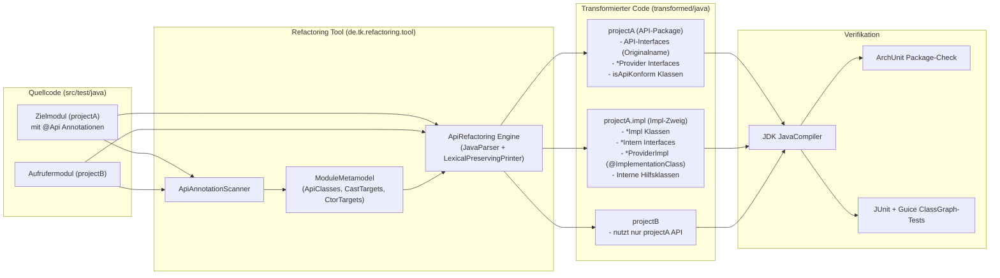

# JavaParser-basierte API/Impl-Codetransformation zur Reduktion transitiver Modulabhängigkeiten

*   **Author:** Frank Schlüter
*   **Status:** Approved
*   **Date:** 2026-11-12

--------------------------------------------------------------------------------

## Overview

Dieses Design beschreibt ein auf JavaParser, Google Guice, ClassGraph, ArchUnit und JUnit basierendes Refactoring-Werkzeug (`de.tk.refactoring.tool`). Das Werkzeug trennt in einem zu transformierenden Zielmodul die von außen genutzte Modul-API von den internen Implementierungsklassen. Dadurch werden transitive Abhängigkeiten zwischen Modulen minimiert: Externe Module hängen nach der Transformation nur noch von API-Interfaces, API-konformen Klassen (`isApiKonform = true`) und Factory-Provider-Interfaces ab, während sämtliche Implementierungsdetails, `*Intern`-Interfaces und internen Hilfsklassen im `impl`-Packagezweig gekapselt sind.

## The Problem

In gewachsenen Java-Systemen nutzen abhängige Module häufig direkt konkrete Implementierungsklassen eines Zielmoduls (Methodenaufrufe, Konstruktoren, statische Methoden und Konstanten). Da diese Implementierungsklassen intern weitere Klassen, Bibliotheken und Infrastruktur-Typen referenzieren, ziehen abhängige Module die gesamte transitive Hülle der Implementierungsschicht in ihren Compile- und Laufzeit-Classpath.

Eine manuelle Entkopplung in großen Codebasen ist fehleranfällig, weil:
1. Externe Module möglichst wenig geändert werden sollen, wenn noch kein dediziertes API-Interface existiert (Imports, Typreferenzen sowie Methoden- und Feldzugriffe bleiben unverändert; lediglich Konstruktor-Aufrufe `new <Name>(...)` werden auf `<Name>.create(...)` umgestellt).
2. Innerhalb des Zielmoduls weiterhin interne Methoden auf Objekten aufgerufen werden müssen, deren Methodensignaturen (Parameter und Rückgabewerte) auf das neue API-Interface umgestellt wurden.
3. Konstruktor-Aufrufe und statische Methodenaufrufe auf ehemaligen Implementierungsklassen über Dependency Injection (Google Guice) aufgelöst werden müssen, ohne dass das API-Package eine Compile-Abhängigkeit auf das `impl`-Package erhält.
4. Vererbungshierarchien zwischen API-Klassen konsistent sowohl auf Ebene der API-Interfaces als auch auf Ebene der internen Interfaces (`*Intern`) abgebildet werden müssen.

### Proposed Solution

Auf Basis eines aus einer vorgelagerten AST-/Abhängigkeitsanalyse stammenden Metamodells führt `de.tk.refactoring.tool.ApiRefactoring` folgende automatisierte Transformationen auf einer Kopie des Quellcodes (`transformed/java`) durch:
* **API-konforme Klassen (`isApiKonform == true`):** Bleiben unverändert im API-Package und dürfen direkt in API-Signaturen verwendet werden.
* **Nicht-API-konforme Klassen ohne bestehendes API-Interface:**
  * Unter dem **exakten vollqualifizierten Originalnamen** der Klasse wird im API-Package ein neues API-Interface erzeugt, das alle bestehenden externen bzw. API-konformen Interfaces der Klasse erweitert und alle als API genutzten Methoden sowie `public static final` Felder enthält.
  * Die ursprüngliche Klasse wird in `<Name>Impl` umbenannt und in den konfigurierbaren `impl`-Packagezweig verschoben.
* **Nicht-API-konforme Klassen mit bestehendem API-Interface:**
  * Das bestehende API-Interface wird bei Bedarf um fehlende API-Methoden ergänzt.
  * Die Implementierungsklasse behält ihren Namen, wird in den `impl`-Packagezweig verschoben, und Referenzen auf die Implementierungsklasse in API-Signaturen sowie in externen Modulen werden durch das bestehende API-Interface ersetzt.
* **Intern-Interface (`<Name>Intern`):**
  * Für intern genutzte (nicht zur API gehörende) öffentliche Methoden einer Implementierungsklasse wird im `impl`-Packagezweig ein Interface `<Name>Intern extends <ApiInterface>` erzeugt, das von der Implementierungsklasse (`<Name>Impl` bzw. `<Name>` bei bestehendem API-Interface) implementiert wird.
  * An allen in den Analyse-Metadaten (per Zeilennummer) benannten Aufrufstellen interner Methoden auf einer API-Interface-Referenz wird der Aufruf-Scope syntaktisch in einen geklammerten Cast `((<Name>Intern) scope).internalMethod()` eingewickelt (siehe [InternCastOhneResolve.MD](./InternCastOhneResolve.MD)).
* **Konstruktoren & statische Methoden über Guice-Provider:**
  * Im API-Package wird ein Factory-Interface `<Name>Provider` mit entsprechenden `create(...)`-Methoden (für genutzte Konstruktoren) und Wrapper-Methoden (für genutzte `static`-Methoden) erzeugt.
  * Im `impl`-Packagezweig wird `<Name>ProviderImpl implements <Name>Provider` mit einem über `@de.tk.util.injection.ImplementationClass` und `@jakarta.inject.Inject` markierten Konstruktor generiert. Ein ClassGraph-basierter Guice-Scanner bindet beim Start alle `@ImplementationClass`-Klassen automatisch an ihre Interfaces und führt `requestStaticInjection` für die API-Provider-Holder aus.
  * Das API-Interface hält über einen eingebetteten statischen Holder (`public static <Name>Provider provider;`) eine per `@jakarta.inject.Inject` injizierte Referenz auf `<Name>Provider` und bietet statische `create(...)`- sowie statische Wrapper-Methoden an. Konstruktor-Aufrufe `new <Name>(...)` an den in den Metadaten genannten Zeilennummern werden durch `<ApiInterface>.create(...)` ersetzt.
* **Vererbung:**
  * Wenn `SubClass` von `BaseClass` erbt, erweitert das API-Interface von `SubClass` das API-Interface von `BaseClass`, und `SubClassIntern` erweitert `BaseClassIntern` (sowie das API-Interface `SubClass`).

## Goals

*   **G1 – Vollständiges Abhängigkeits-Metamodell:** Abbildung aller von außen genutzten API-Klassen (`isApiKonform`), API-Methoden, statischen Methoden, Konstanten und Konstruktoren sowie der Zeilennummern-Listen für Intern-Casts und Konstruktor-Aufrufe.
*   **G2 – `@Api`-basierter Test-Scanner:** Automatische Erzeugung des Metamodells aus mit `@de.tk.dependencyanalyse.transformation.Api` annotiertem Testcode, um Testszenarien deklarativ definieren zu können.
*   **G3 – Rein syntaktische AST-Transformation:** Durchführung der Code-Transformation über JavaParser (`LexicalPreservingPrinter`) ausschließlich anhand des Metamodells und der Zeilennummern ohne zur Transformationszeit einen SymbolSolver zu benötigen.
*   **G4 – Strikte Trennung von API- und Impl-Packagezweig:** Keinerlei Compile-Abhängigkeiten vom API-Packagezweig in den `impl`-Packagezweig, automatisiert geprüft durch einen ArchUnit-Test.
*   **G5 – Zerstörungsfreie Verifikation (`transformed/java`):** Der Originalcode bleibt unverändert; der transformierte Code wird nach `transformed/java` geschrieben, kompiliert und durchläuft dieselben fachlichen JUnit-Tests (intern und extern inkl. Guice-Injektion) wie der Originalcode.

## Non-Goals

*   **NG1 – Keine Änderung fachlicher Methodenrümpfe (außer Typ-Ersetzungen, Casts und Konstruktor-Aufrufen):** Die Geschäftslogik innerhalb der Implementierungsklassen wird nicht verändert.
*   **NG2 – Keine Auslagerung mutabler `static`-Felder oder nicht-statischer Felder in Interfaces:** Da Java-Interfaces nur `public static final` Konstanten erlauben, werden nur statische Konstanten in das API-Interface verschoben.
*   **NG3 – Keine Build-System-Migration:** Das Tool transformiert Java-Quellcode (`CompilationUnit`s), passt aber keine `pom.xml`-Dateien externer Produkte an.

## Open Questions

Keine offenen Architekturfragen.

## Critical User Journeys (CUJs)

### CUJ 1: Transformation einer Implementierungsklasse ohne bestehendes API-Interface

*   **Given**: Eine Klasse `de.tk.refactoring.test.projectA.CustomerService` ohne bestehendes Interface, bei der ein Teil der Methoden, ein Konstruktor, eine `static`-Methode und eine `public static final`-Konstante mit `@Api` markiert sind (`isApiKonform = false`), sowie weitere nur intern genutzte Methoden.
*   **When**: Der Metamodell-Scanner und anschließend `ApiRefactoring` auf einer Kopie des Projekts ausgeführt werden.
*   **Then**:
    *   `de.tk.refactoring.test.projectA.CustomerService` ist nun ein API-Interface mit den API-Methoden, der Konstante, der statischen Wrapper-Methode und `static CustomerService create(...)`.
    *   `de.tk.refactoring.test.projectA.CustomerServiceProvider` existiert im API-Package.
    *   `de.tk.refactoring.test.projectA.impl.CustomerServiceImpl` und `CustomerServiceProviderImpl` (mit `@ImplementationClass`) sowie `CustomerServiceIntern` liegen im `impl`-Packagezweig.
    *   Interne Aufrufe von Nicht-API-Methoden auf `CustomerService`-Referenzen sind mit `((CustomerServiceIntern) ...)` gecastet; `new CustomerService(...)` an API-Aufrufstellen ist durch `CustomerService.create(...)` ersetzt.
    *   Der ArchUnit-Test bestätigt null Abhängigkeiten von API nach `impl`, und alle internen sowie externen JUnit-Tests laufen vor und nach der Transformation grün.

### CUJ 2: Transformation einer Implementierungsklasse mit bestehendem, unvollständigem API-Interface

*   **Given**: Eine Klasse `AccountService`, die bereits `AccountServiceApi` implementiert, aber zusätzliche mit `@Api` markierte Methoden besitzt, die noch nicht in `AccountServiceApi` deklariert sind. Externe Klassen in `projectB` und interne API-Methoden referenzieren noch den Typ `AccountService`.
*   **When**: `ApiRefactoring` ausgeführt wird.
*   **Then**:
    *   `AccountServiceApi` wird um die fehlenden API-Methoden ergänzt.
    *   `AccountService` wird ohne Umbenennung in das `impl`-Package verschoben; für interne Methoden wird `AccountServiceIntern extends AccountServiceApi` im `impl`-Zweig erzeugt.
    *   In API-Methodensignaturen von `projectA` und in den nutzenden Klassen von `projectB` werden Typreferenzen und Imports von `AccountService` auf `AccountServiceApi` umgeschrieben.

### CUJ 3: Transformation einer Vererbungshierarchie und interner Klassen

*   **Given**: Eine Basisklasse `BaseProcessor` (`isApiKonform = false`), eine davon erbende Klasse `SpecialProcessor` (`isApiKonform = false`), eine rein interne Hilfsklasse `InternalHelper` (ohne `@Api`) und ein API-konformes Wertobjekt `ProcessorConfig` (`isApiKonform = true`).
*   **When**: `ApiRefactoring` ausgeführt wird.
*   **Then**:
    *   Das API-Interface `SpecialProcessor` erweitert das API-Interface `BaseProcessor`; `SpecialProcessorIntern` erweitert `BaseProcessorIntern` und `SpecialProcessor`; `SpecialProcessorImpl` erweitert `BaseProcessorImpl` und implementiert `SpecialProcessorIntern`.
    *   `InternalHelper` wird komplett in das `impl`-Package verschoben und alle Imports darauf im `impl`-Zweig werden angepasst.
    *   `ProcessorConfig` (`isApiKonform = true`) bleibt unverändert im API-Package.

## Technical Plan (Architecture)

### 1. Systemarchitektur & Datenfluss

Die Architektur gliedert sich in vier Subsysteme:
1. **Metamodell (`de.tk.refactoring.tool.model`):** Unveränderliche Datenstrukturen (Java Records), die das Ergebnis der Abhängigkeitsanalyse beschreiben.
2. **Test-Metamodell-Scanner (`de.tk.refactoring.tool.scanner`):** Liest mit `@de.tk.dependencyanalyse.transformation.Api` annotierte Quellbäume über JavaParser ein und erzeugt daraus ein vollständiges `ModuleMetamodel` inklusive der Zeilennummern-Listen für Intern-Casts und Konstruktor-Aufrufe.
3. **AST-Transformations-Engine (`de.tk.refactoring.tool`):** Nimmt die geparsten `CompilationUnit`s sowie das `ModuleMetamodel` entgegen und führt alle Code-Generierungen, Umbenennungen, Package-Verschiebungen, Typ-Ersetzungen, Intern-Casts und Konstruktor-Ersetzungen rein syntaktisch (ohne `JavaSymbolSolver`) durch.
4. **Guice-Laufzeit-Infrastruktur (`de.tk.util.injection`):** Enthält die Annotation `@ImplementationClass` und das `ClassGraphGuiceModule`, das zur Laufzeit das Classpath nach `@ImplementationClass`-Provider-Implementierungen scannt, diese an ihre API-Provider-Interfaces bindet und statische Provider-Holder in den API-Interfaces per `requestStaticInjection` injiziert.



### 2. Metamodell-Design (`de.tk.refactoring.tool.model`)

Das Metamodell besteht aus folgenden unveränderlichen Record-Strukturen:
* **`ModuleMetamodel`:**
  * `String targetModulePackage` (z. B. `de.tk.refactoring.test.projectA`)
  * `String implSubPackage` (konfigurierbar, Standard: `impl`, ergibt `de.tk.refactoring.test.projectA.impl`)
  * `List<ApiClassMetadata> apiClasses`: Liste aller von anderen Modulen als API verwendeten Klassen und Interfaces (zusätzlich über `apiClassesByFqn()` als Map abrufbar).
  * `List<InternCastTarget> internCastTargets`: Vorberechnete Liste der durchzuführenden Intern-Casts.
  * `List<ConstructorCallTarget> constructorCallTargets`: Vorberechnete Liste der zu ersetzenden Konstruktor-Aufrufe.
* **`ApiClassMetadata`:**
  * `String fullyQualifiedName`: Ursprünglicher FQN der Klasse oder des Interfaces.
  * `boolean isApiKonform`: Falls `true`, bleibt die Klasse inklusive ihrer transitiven Hülle unverändert als API bestehen. Falls `false`, wird sie durch ein API-Interface abgelöst.
  * `Optional<String> existingApiInterfaceFqn`: Falls bereits ein geeignetes Interface existiert, dessen FQN; sonst `Optional.empty()`.
  * `Optional<String> superClassFqn`: FQN der Basisklasse, falls die Klasse von einer anderen Modulklasse erbt.
  * `List<String> implementedInterfaces`: Liste der von der Klasse implementierten Interfaces.
  * `List<MethodSignature> apiMethods`: Genutzte Instanzmethoden der API.
  * `List<MethodSignature> internalMethods`: Nur intern genutzte öffentliche Instanzmethoden, die in das `<Name>Intern`-Interface aufgenommen werden.
  * `List<MethodSignature> staticApiMethods`: Von außen genutzte `static`-Methoden.
  * `List<FieldMetadata> staticApiFields`: Von außen genutzte `public static final` Felder.
  * `List<ConstructorSignature> apiConstructors`: Von außen genutzte Konstruktoren.
  * Hilfsmethoden:
    * `effectiveApiInterfaceFqn()`: Liefert `existingApiInterfaceFqn.orElse(fullyQualifiedName)`.
    * `effectiveImplSimpleName()`: Liefert `<SimpleName>` falls `existingApiInterfaceFqn.isPresent()`, sonst `<SimpleName>Impl`.
* **`InternCastTarget`:**
  * `String targetClassFqn`: Name der zu refaktorisierenden Klasse, in der der Aufruf steht.
  * `String methodName`: Name der aufgerufenen internen Methode.
  * `int lineNumber`: 1-basierte Zeilennummer des zu refaktorisierenden `MethodCallExpr` im Originalcode.
  * `String internInterfaceFqn`: Vollqualifizierter Name des `*Intern`-Interfaces, auf das der Scope gecastet werden soll.
* **`ConstructorCallTarget`:**
  * `String targetClassFqn`: Name der zu refaktorisierenden Klasse, in der `new ...` steht.
  * `String instantiatedClassFqn`: Name der erzeugten Implementationsklasse.
  * `String providerInterfaceFqn`: Name des Factory-Interfaces (`*Provider`), das durch Guice injiziert wird.
  * `int lineNumber`: 1-basierte Zeilennummer des `ObjectCreationExpr` (`new ...`) im Originalcode.

### 3. Transformations-Regeln im Detail

1. **Klassen-Klassifikation im Zielmodul:**
   * **Fall 1 (`isApiKonform = true` oder bereits reines Interface):** Bleibt im API-Package unverändert.
   * **Fall 2 (`isApiKonform = false`, kein `existingApiInterfaceFqn`):**
     * Neues API-Interface erhält den FQN der Originalklasse (`<pkg>.<Name>`) und erweitert alle bisher von der Klasse implementierten externen bzw. API-konformen Interfaces sowie bei Vererbung das API-Interface der Basisklasse.
     * Die Originalklasse wird zu `<pkg>.impl.<Name>Impl` verschoben/umbenannt, erweitert ggf. `<Base>Impl` und implementiert `<Name>Intern` (oder `<Name>`, falls keine internen Methoden existieren).
   * **Fall 3 (`isApiKonform = false`, mit `existingApiInterfaceFqn`):**
     * Das bestehende Interface wird um fehlende `apiMethods` ergänzt.
     * Die Implementierungsklasse behält ihren einfachen Klassennamen (`effectiveImplSimpleName()` = `<Name>`), wird aber nach `<pkg>.impl.<Name>` verschoben und implementiert `<Name>Intern`.
     * Alle Typreferenzen auf `<Name>` in API-Signaturen und in externen Modulen (`projectB`) werden auf das bestehende Interface (`existingApiInterfaceFqn`) umgeschrieben.
   * **Fall 4 (Rein interne Klasse, nicht in `apiClasses`):**
     * Wird vollständig in das `<pkg>.impl`-Package verschoben; alle Referenzen und Imports innerhalb des Zielmoduls werden aktualisiert, inklusive expliziter Imports auf Typen, die im Basis-API-Package verbleiben.

2. **Aufbau von API-Interface, `Provider` und `ProviderImpl`:**
   * Sofern `apiConstructors` oder `staticApiMethods` nicht leer sind, wird im API-Package `<Name>Provider` mit `create(...)`-Methoden (Rückgabetyp: `effectiveApiInterfaceSimpleName()`) und Instanz-Wrapper-Methoden für alle `staticApiMethods` generiert.
   * Im `impl`-Package wird `<Name>ProviderImpl implements <Name>Provider` generiert. Der Konstruktor von `<Name>ProviderImpl` erhält `@de.tk.util.injection.ImplementationClass` und `@jakarta.inject.Inject`. Die `create(...)`-Methoden rufen `new <effectiveImplSimpleName()>(...)` auf; die Wrapper-Methoden delegieren an `<effectiveImplSimpleName()>.<staticMethod>(...)`.
   * Im API-Interface (`effectiveApiInterfaceSimpleName()`) wird ein eingebetteter statischer Holder generiert:
     ```java
     class ProviderHolder {
         @jakarta.inject.Inject
         public static <Name>Provider provider;
     }
     ```
     Für jeden `apiConstructor` erhält das API-Interface eine `static <ApiType> create(...)`-Methode, die `return ProviderHolder.provider.create(...);` aufruft. Analog rufen statische Wrapper-Methoden im API-Interface `ProviderHolder.provider.<staticMethod>(...)` auf.

3. **Aufbau des `<Name>Intern`-Interfaces und Vererbung:**
   * Im `<pkg>.impl`-Package wird `public interface <Name>Intern extends <effectiveApiInterfaceSimpleName()>` (sowie bei Vererbung zusätzlich `, <BaseName>Intern`) angelegt.
   * Es enthält die Signaturen aller `internalMethods`.
   * Wenn eine Methode in `<effectiveImplSimpleName()>` Parameter oder Rückgabewerte vom Typ einer nicht-API-konformen Klasse verwendet und diese Methode eine API-Methode (oder überschriebene Methode) ist, werden deren Parameter- und Rückgabetypen auf das jeweilige API-Interface (`effectiveApiInterfaceSimpleName()`) umgestellt.

4. **Syntaktische Zeilennummern-Transformationen (Casts & Konstruktoren) sowie interne Direktreferenzen:**
   * Unmittelbar nach dem initialen Parsen einer `CompilationUnit` wird `LexicalPreservingPrinter.setup(cu)` aktiviert. Zeilennummernbasierte Transformationen (`CastAndConstructorInjector`) laufen zuerst in-memory auf dem Original-AST, bevor Package-/Klassen-Header oder Feldentfernungen durchgeführt werden, sodass die 1-basierten Original-Zeilennummern exakt erhalten bleiben.
   * **Intern-Casts:** Für jedes `InternCastTarget` einer Klasse wird der `MethodCallExpr` mit passendem Methodennamen und passender Original-Zeilennummer (`call.getName().getBegin().line == target.lineNumber()` oder `call.getBegin().line == target.lineNumber()`) gesucht. Sofern `call.getScope().isPresent()` und noch kein Cast auf `internType` vorliegt (`!isAlreadyCastTo(...)`), wird der `scope` geklont und in `new EnclosedExpr(new CastExpr(internType, scope.clone()))` eingewickelt sowie der Import für `internInterfaceFqn` ergänzt.
   * **Konstruktor-Aufrufe vs. interne Direktreferenzen im `impl`-Package:**
     * Für jedes `ConstructorCallTarget` einer Klasse wird die `ObjectCreationExpr` (`new <Name>(args)`) auf der Zielzeile durch den statischen Methodenaufruf `<effectiveApiInterfaceSimpleName()>.create(args)` ersetzt (`providerInterfaceFqn` ist im Record für die vollständige Metamodell-Spezifikation enthalten).
     * Innerhalb des `impl`-Packages gilt für direkte Implementierungsreferenzen folgende deterministische syntaktische Regel: Nicht-API-Felder (und zugehörige Konstruktor-/Feld-Initialisierungen) einer internen Klasse, die im selben Modul direkt per `new <Name>(...)` (ohne Eintrag in `constructorCallTargets`) initialisiert werden und keinen `existingApiInterfaceFqn` besitzen, werden samt ihrem `new`-Aufruf auf `<Name>Impl` (`new <Name>Impl(...)`) umgeschrieben. Dadurch können auf solchen internen Feldern interne Methoden direkt ohne Cast aufgerufen werden, während Rückgabewerte von API-Methoden den API-Interface-Typ `<Name>` liefern und bei internen Methodenaufrufen über `InternCastTarget` gecastet werden.

## Alternatives Considered

### Alternative A: Neues API-Interface in separatem `.api`-Subpackage mit Namenssuffix `Api`

*   **Pros**: Erlaubt es, die Implementierungsklasse ohne Umbenennung an ihrem ursprünglichen Ort zu belassen.
*   **Cons**: Jedes externe Modul, das die Klasse bisher verwendet hat, muss sämtliche Imports und Typdeklarationen anpassen.
*   **Reason for Rejection**: Rejected by author: Wenn noch kein API-Interface existiert, sollen alle Imports, Typreferenzen sowie Methoden- und Feldzugriffe in externen Modulen unverändert bleiben (lediglich `new <Name>(...)`-Konstruktoraufrufe werden auf `<Name>.create(...)` umgestellt). Durch Vergabe des exakten vollqualifizierten Originalnamens an das neue API-Interface bleiben externe Typreferenzen unverändert gültig.

### Alternative B: Direkte `@Inject`-Injektion des `Provider`-Interfaces in jede aufrufende Klasse statt statischer `create`-Methode im API-Interface

*   **Pros**: Vermeidet statische Holder-Klassen innerhalb des API-Interfaces.
*   **Cons**: Jede aufrufende Klasse (auch in externen Modulen und in nicht von Guice erzeugten POJOs) müsste um ein `@Inject`-Feld erweitert und zwingend über Guice instanziiert werden.
*   **Reason for Rejection**: Rejected by author: Damit aufrufender Code minimal invasiv angepasst werden kann (und bei statischen Methoden überhaupt nicht geändert werden muss), kapselt das API-Interface den `@Inject`-Provider hinter statischen `create(...)`- und Wrapper-Methoden.

### Alternative C: Verwendung von Guice `@ImplementedBy` am API-`Provider`-Interface

*   **Pros**: Kein ClassGraph-Scan beim Start des Guice-Injectors erforderlich.
*   **Cons**: `@ImplementedBy(OrderServiceProviderImpl.class)` steht im Quellcode des API-Interfaces und erzeugt damit eine harte Compile-Abhängigkeit vom API-Package in das `impl`-Package.
*   **Reason for Rejection**: Rejected by author: Verletzt die zentrale Architekturvorgabe, dass der API-Packagezweig keinerlei Abhängigkeiten zum `impl`-Packagezweig haben darf. Stattdessen wird `@de.tk.util.injection.ImplementationClass` in der Implementierungsschicht zusammen mit einem ClassGraph-Scanner eingesetzt.

--------------------------------------------------------------------------------

## Non-Functional Requirements

*   **Architektur-Invariante (Zero API-to-Impl Dependency):** Klassen im API-Packagezweig (`de.tk.refactoring.test.projectA`) dürfen weder direkt noch transitiv Typen aus `de.tk.refactoring.test.projectA.impl` importieren oder referenzieren. Dies wird durch einen dedizierten ArchUnit-Test erzwungen.
*   **Zeilennummern-Stabilität & Formatierungserhalt:** Mehrere Cast- und Konstruktor-Transformationen innerhalb derselben Datei dürfen sich nicht gegenseitig durch verschobene Zeilennummern beeinflussen; die ursprünglichen AST-Ranges von JavaParser sowie der `LexicalPreservingPrinter` werden genutzt.
*   **Zerstörungsfreie Ausführung & Quellordner-Isolation:** Die Originalquellen unter `src/test/java` werden niemals überschrieben; alle Ausgaben landen unter `transformed/java` und werden isoliert nach `target/transformed-classes` kompiliert. Im optionalen Maven-Profil `compile-transformed` schließt `maven-compiler-plugin` die Original-Testpackages `de/tk/refactoring/test/projectA/**` und `de/tk/refactoring/test/projectB/**` aus `src/test/java` per `<testExcludes>` aus, wenn `transformed/java` als zusätzlicher Source-Folder eingebunden wird.

--------------------------------------------------------------------------------

## Additional Resources

*   [InternCastOhneResolve.MD](./InternCastOhneResolve.MD) – Voranalyse zur zeilennummernbasierten AST-Transformation mit JavaParser ohne SymbolSolver.
*   [Prompt.txt](./Prompt.txt) – Ursprüngliche Vorstudie zu den Testszenarien.
*   [concepts_brief.md](./concepts_brief.md) – Abgestimmtes Brainstorming-Konzeptdokument.

--------------------------------------------------------------------------------

## Detailed Implementation Plan

### Target Files to Create/Modify

#### 1. `pom.xml` ([Create])

*   **Type / Scope**: Maven Build Configuration (Java 21)
*   **Proposed Changes**:
    *   Definiert das Maven-Projekt `de.tk.refactoring:api-code-refactoring:1.0.0-SNAPSHOT` mit `maven.compiler.release` 21.
    *   Abhängigkeiten:
        *   `com.github.javaparser:javaparser-core:3.26.2`
        *   `com.google.inject:guice:7.0.0` und `jakarta.inject:jakarta.inject-api:2.0.1`
        *   `io.github.classgraph:classgraph:4.8.174` (für den `@ImplementationClass`-Classpath-Scanner)
        *   `org.junit.jupiter:junit-jupiter:5.11.0`
        *   `com.tngtech.archunit:archunit-junit5:1.3.0`
    *   Konfiguriert ein optionales Maven-Profil `compile-transformed` mit `build-helper-maven-plugin` (`add-test-source` für `transformed/java`) und `<testExcludes>` im `maven-compiler-plugin` für `de/tk/refactoring/test/projectA/**` und `de/tk/refactoring/test/projectB/**` aus `src/test/java`, damit keine `duplicate class`-Konflikte auftreten. In der Standard-Testausführung (`mvn test`) generiert der JUnit-Verifikationstest `transformed/java`, kompiliert ihn per `javax.tools.JavaCompiler` nach `target/transformed-classes` und prüft ihn per JUnit und ArchUnit.

#### 2. `src/main/java/de/tk/dependencyanalyse/transformation/Api.java` ([Create])

*   **Type / Scope**: Java Annotation
*   **Proposed Changes**:
    *   Definiert `@Retention(RetentionPolicy.RUNTIME)` und `@Target({ElementType.TYPE, ElementType.METHOD, ElementType.FIELD, ElementType.CONSTRUCTOR})`.
    *   Enthält `boolean isApiKonform() default false;`, um an Typen deklarativ im Testcode zu steuern, ob eine Klasse als API-konform (`true`) oder als durch ein Interface abzulösende Implementierungsklasse (`false`) gilt.

#### 3. `src/main/java/de/tk/util/injection/ImplementationClass.java` ([Create])

*   **Type / Scope**: Java Annotation für Google Guice Binding Discovery
*   **Proposed Changes**:
    *   Definiert `@Retention(RetentionPolicy.RUNTIME)` und `@Target({ElementType.TYPE, ElementType.CONSTRUCTOR})`.
    *   Wird an den generierten `*ProviderImpl`-Konstruktoren bzw. Klassen im `impl`-Package angebracht.

#### 4. `src/main/java/de/tk/util/injection/ClassGraphGuiceModule.java` ([Create])

*   **Type / Scope**: Google Guice Module mit ClassGraph-Scanner
*   **Proposed Changes**:
    *   Erweitert `com.google.inject.AbstractModule`.
    *   Nimmt im Konstruktor ein oder mehrere Basis-Packages (`String... scanPackages`) und einen optionalen `ClassLoader` (für das isolierte Laden der kompilierten Klassen aus `target/transformed-classes`) entgegen.
    *   Konfiguriert `ClassGraph` mit `.enableAllInfo().ignoreFieldVisibility().acceptPackages(scanPackages)` sowie bei übergebenem `classLoader` zwingend mit `.overrideClassLoaders(classLoader)`, damit nicht versehentlich die untransformierten Klassen aus `target/test-classes` gescannt werden.
    *   Scannt nach allen Klassen mit `@ImplementationClass` (an Klasse oder Konstruktor), ermittelt deren implementiertes `*Provider`-Interface im API-Package und führt `bind(providerInterface).to(providerImplClass)` aus.
    *   Sucht zudem in den gescannten API-Interfaces nach eingebetteten `ProviderHolder`-Klassen mit `@jakarta.inject.Inject public static`-Feldern und registriert diese über `requestStaticInjection(holderClass)`.

#### 5. `src/main/java/de/tk/refactoring/tool/model/MethodSignature.java` ([Create])

*   **Type / Scope**: Metamodell-Record
*   **Proposed Changes**:
    *   `public record MethodSignature(String name, String returnType, List<ParameterSpec> parameters, List<String> typeParameters, List<String> thrownExceptions) {}` sowie `public record ParameterSpec(String type, String name) {}`.

#### 6. `src/main/java/de/tk/refactoring/tool/model/FieldMetadata.java` ([Create])

*   **Type / Scope**: Metamodell-Record
*   **Proposed Changes**:
    *   `public record FieldMetadata(String name, String type, String initializerExpr) {}` zur Repräsentation von `public static final` API-Feldern.

#### 7. `src/main/java/de/tk/refactoring/tool/model/ConstructorSignature.java` ([Create])

*   **Type / Scope**: Metamodell-Record
*   **Proposed Changes**:
    *   `public record ConstructorSignature(List<MethodSignature.ParameterSpec> parameters, List<String> thrownExceptions) {}`.

#### 8. `src/main/java/de/tk/refactoring/tool/model/ApiClassMetadata.java` ([Create])

*   **Type / Scope**: Metamodell-Record für eine API-Klasse
*   **Proposed Changes**:
    *   Enthält `String fullyQualifiedName`, `boolean isApiKonform`, `Optional<String> existingApiInterfaceFqn`, `Optional<String> superClassFqn`, `List<String> implementedInterfaces`, `List<MethodSignature> apiMethods`, `List<MethodSignature> internalMethods`, `List<MethodSignature> staticApiMethods`, `List<FieldMetadata> staticApiFields`, `List<ConstructorSignature> apiConstructors` sowie die Hilfsmethoden `effectiveApiInterfaceFqn()`, `effectiveApiInterfaceSimpleName()` und `effectiveImplSimpleName()`.

#### 9. `src/main/java/de/tk/refactoring/tool/model/InternCastTarget.java` ([Create])

*   **Type / Scope**: Metamodell-Record für zeilennummernbasierte Intern-Casts
*   **Proposed Changes**:
    *   `public record InternCastTarget(String targetClassFqn, String methodName, int lineNumber, String internInterfaceFqn) {}`.

#### 10. `src/main/java/de/tk/refactoring/tool/model/ConstructorCallTarget.java` ([Create])

*   **Type / Scope**: Metamodell-Record für zeilennummernbasierte Konstruktor-Ersetzungen
*   **Proposed Changes**:
    *   `public record ConstructorCallTarget(String targetClassFqn, String instantiatedClassFqn, String providerInterfaceFqn, int lineNumber) {}`.

#### 11. `src/main/java/de/tk/refactoring/tool/model/ModuleMetamodel.java` ([Create])

*   **Type / Scope**: Aggregiertes Metamodell für die Modul-Transformation
*   **Proposed Changes**:
    *   `public record ModuleMetamodel(String targetModulePackage, String implSubPackage, List<ApiClassMetadata> apiClasses, List<InternCastTarget> internCastTargets, List<ConstructorCallTarget> constructorCallTargets)` inklusive Hilfsmethoden `Map<String, ApiClassMetadata> apiClassesByFqn()` und `String implPackageFqn()`.

#### 12. `src/main/java/de/tk/refactoring/tool/scanner/ApiAnnotationScanner.java` ([Create])

*   **Type / Scope**: AST-Analyse-Scanner zur Erzeugung des `ModuleMetamodel` aus `@Api`-annotiertem Code
*   **Proposed Changes**:
    *   Methode `public static ModuleMetamodel scan(List<CompilationUnit> units, String targetModulePackage, String implSubPackage)`.
    *   Ermittelt alle Klassen im `targetModulePackage`, wertet `@Api` an Klassen (`isApiKonform`), Methoden (`static` vs. Instanz), Feldern und Konstruktoren aus.
    *   Erkennt bestehende API-Interfaces (wenn eine Klasse ein Interface aus dem Modul implementiert, das `@Api` trägt oder API-Methoden deklariert).
    *   Ermittelt für die Testszenarien automatisch alle Zeilennummern in `units`, an denen:
        1. auf einer Referenz, deren statischer Typ nach der Transformation ein API-Interface ist (Methodenparameter, lokale Variable mit API-Typ oder direkter Rückgabewert einer API-Methode), eine Methode aus `internalMethods` (inkl. geerbter interner Methoden der Basisklasse) aufgerufen wird (`InternCastTarget`),
        2. ein mit `@Api` markierter Konstruktor einer nicht-API-konformen Klasse per `new` in einem externen Modul (`projectB`) oder für eine API-typisierte Variable aufgerufen wird (`ConstructorCallTarget`). Direkte Initialisierungen interner Felder in Klassen des Zielmoduls (`private OrderService directField = new OrderService(...)` bzw. im Konstruktor für dieses interne Feld) werden **nicht** als `ConstructorCallTarget` erfasst, sondern für die direkte `*Impl`-Nutzung vorgesehen.

#### 13. `src/main/java/de/tk/refactoring/tool/CastAndConstructorInjector.java` ([Create])

*   **Type / Scope**: Syntaktischer AST-Transformator für Zeilennummern-Targets
*   **Proposed Changes**:
    *   Setzt die in [InternCastOhneResolve.MD](./InternCastOhneResolve.MD) beschriebene Logik um:
        *   `applyInternCasts(CompilationUnit cu, List<InternCastTarget> targets)`: Sucht `MethodCallExpr` anhand `methodName` und `matchesLine(call, target.lineNumber())` (prüft `call.getName().getBegin()` und `call.getBegin()`), prüft `call.getScope().isPresent()` und `!isAlreadyCastTo(scope, simpleInternName)`, klont den `scope`, verpackt ihn in `new EnclosedExpr(new CastExpr(internType, scope.clone()))` und fügt den Import für `internInterfaceFqn` hinzu.
        *   `applyConstructorReplacements(CompilationUnit cu, List<ConstructorCallTarget> targets, ModuleMetamodel metamodel)`: Sucht `ObjectCreationExpr` anhand `lineNumber` und Typname und ersetzt `new MyClass(args)` durch den statischen Methodenaufruf `<effectiveApiInterfaceSimpleName>.create(args)`.

#### 14. `src/main/java/de/tk/refactoring/tool/ApiRefactoring.java` ([Create])

*   **Type / Scope**: Hauptklasse des Refactoring-Tools
*   **Proposed Changes**:
    *   Bietet:
        *   `public static void replaceImplUsage(CompilationUnit implClass)` (1-Argument-Überladung gemäß Spezifikation, die mit dem aktuell konfigurierten bzw. per Scanner aus `implClass` abgeleiteten `ModuleMetamodel` an die 2-Argument-Methode delegiert),
        *   `public static void replaceImplUsage(CompilationUnit cu, ModuleMetamodel metamodel)`,
        *   `public static List<CompilationUnit> transformProject(List<CompilationUnit> sourceUnits, ModuleMetamodel metamodel)`,
        *   `public static ModuleMetamodel transformDirectory(Path sourceRoot, Path targetRoot, String targetModulePackage, String implSubPackage)` (parst alle Quellen unter `sourceRoot`, ruft `ApiAnnotationScanner.scan(...)` auf, führt `transformProject(...)` aus und schreibt alle resultierenden Dateien nach `targetRoot`).
    *   Führt für das Zielmodul in dieser Reihenfolge durch:
        1. Aktivierung von `LexicalPreservingPrinter.setup(cu)` unmittelbar nach dem Parsen und Ausführung von `CastAndConstructorInjector` auf den Original-Zeilennummern im Speicher.
        2. Generierung neuer API-Interfaces (inkl. `public static final` Konstanten, statischer `create`-Methoden, statischer Wrapper-Methoden und `ProviderHolder` mit `@jakarta.inject.Inject public static <Name>Provider provider;`).
        3. Ergänzung fehlender API-Methoden in bestehenden API-Interfaces.
        4. Generierung von `<Name>Provider` im API-Package und `<Name>ProviderImpl` (mit `@ImplementationClass` und `@Inject`-Konstruktor) im `impl`-Package.
        5. Generierung von `<Name>Intern` im `impl`-Package (inkl. Vererbung `extends <effectiveApiInterfaceSimpleName>, <BaseIntern>`).
        6. Umbenennung (`<Name>` -> `<Name>Impl`, sofern kein bestehendes API-Interface vorlag) und Package-Verschiebung aller Implementierungsklassen und internen Hilfsklassen in das `impl`-Package; Entfernen der ins API-Interface verschobenen `public static final` Felder aus der `Impl`-Klasse; Ergänzen expliziter Imports für alle Typen, die im Basis-API-Package verbleiben.
        7. Ersetzung von Implementierungstypen durch API-Interface-Typen in allen API-Methodensignaturen (Parameter und Rückgabewerte) sowie in externen Modulen (`projectB`) in Feldern, Parametern, lokalen Variablen, Rückgabewerten und Imports. Bei internen Direktreferenzen im selben `impl`-Package (nicht-API-Felder und deren direkte `new <Name>(...)`-Initialisierung, die nicht in `constructorCallTargets` stehen) wird der Typ und der Konstruktoraufruf auf `<Name>Impl` (`new <Name>Impl(...)`) aktualisiert, sodass dort kein Cast nötig ist.

#### 15. Test-Szenario-Klassen in `projectA` (Zielmodul) unter `src/test/java/de/tk/refactoring/test/projectA/` ([Create])

*   **Type / Scope**: Annotierter Test-Quellcode für das zu transformierende Zielmodul
*   **Proposed Changes**:
    *   `CustomerData.java`: Mit `@Api(isApiKonform = true)` markierte Wertobjekt-Klasse (bleibt unverändert in der API).
    *   `BaseService.java`: Nicht-API-konforme Basisklasse mit `@Api`-Methode `getBaseId()` und interner Methode `getInternalBaseState()`.
    *   `OrderService.java`: Erbt von `BaseService` (ohne bestehendes Interface). Enthält:
        *   `@Api public static final String DEFAULT_CURRENCY = "EUR";`
        *   `@Api public OrderService(String prefix)` (Konstruktor)
        *   `@Api public static String formatOrderNumber(int num)` (statische API-Methode)
        *   `@Api public String createOrder(CustomerData customer)` (API-Methode)
        *   `@Api public OrderService getCollaborator()` (API-Methode mit nicht-API-konformem Rückgabetyp -> wird zu API-Interface)
        *   `public String calculateInternalAuditHash()` (interne Methode -> wandert in `OrderServiceIntern`)
    *   `BillingServiceApi.java` & `BillingService.java`: Szenario für eine Implementierungsklasse mit **bestehendem, aber unvollständigem API-Interface**. `BillingServiceApi` enthält `calculateTotal(int amount)`, während `BillingService` zusätzlich `@Api public String getInvoiceCode(int amount)` und die interne Methode `resetInternalCounter()` besitzt.
    *   `InternalAuditHelper.java`: Rein interne Klasse ohne `@Api`-Annotation (wird komplett nach `projectA.impl` verschoben).
    *   `InternalWorkflowRunner.java`: Interne Klasse in `projectA`, die alle geforderten internen Szenarien abdeckt:
        1. Ruft `orderService.getCollaborator()` auf (dessen Rückgabetyp zum API-Interface wird) und ruft darauf die interne Methode `calculateInternalAuditHash()` sowie `getInternalBaseState()` (aus der Basisklasse) auf -> benötigt Cast auf `OrderServiceIntern`.
        2. Besitzt ein internes Feld auf eine Implementierungsklasse im selben Modul, das durch den Konstruktor initialisiert wird, und ruft darauf direkt eine interne Methode ohne Cast auf.
        3. Nutzt interne Verwendungen innerhalb von Methoden sowie `BillingService`.

#### 16. Test-Szenario-Klassen in `projectB` (Externes Aufrufer-Modul) unter `src/test/java/de/tk/refactoring/test/projectB/` ([Create])

*   **Type / Scope**: Externer Client-Code zur Prüfung der Modul-API von außen
*   **Proposed Changes**:
    *   `ExternalOrderClient.java`: Nutzt ausschließlich API-Elemente aus `projectA`:
        *   Konstruktor-Aufruf `new OrderService("EXT")` (wird zu `OrderService.create("EXT")`),
        *   statische Methode `OrderService.formatOrderNumber(42)`,
        *   statische Konstante `OrderService.DEFAULT_CURRENCY`,
        *   API-Methoden `createOrder(new CustomerData("Alice"))` und `getBaseId()`,
        *   Referenz auf `BillingService` in Feld, Parameter, lokaler Variable und Rückgabewert (wird bei bestehendem Interface auf `BillingServiceApi` umgeschrieben).

#### 17. `src/test/java/de/tk/refactoring/test/RefactoringEndToEndTest.java` ([Create])

*   **Type / Scope**: JUnit 5 End-to-End-, Compiler-, Laufzeit- und ArchUnit-Test
*   **Proposed Changes**:
    *   **Test 1 (`testOriginalCodeExecutesCorrectly`):** Führt die fachlichen Tests auf dem unveränderten Originalcode (`projectA` und `projectB`) aus.
    *   **Test 2 (`testMetamodelScannerExtractsAllMetadata`):** Prüft, dass `ApiAnnotationScanner` für `projectA` und `projectB` alle API-Klassen, `isApiKonform`-Flags, Methoden, Felder, Konstruktoren sowie die exakten Zeilennummern für `InternCastTarget` und `ConstructorCallTarget` ermittelt.
    *   **Test 3 (`testTransformationAndCompilationInTransformedFolder`):**
        *   Liest die Quellen aus `src/test/java/de/tk/refactoring/test/projectA` und `projectB` als Kopie ein.
        *   Führt `ApiRefactoring.transformDirectory(...)` aus und schreibt den gesamten Ergebniscode nach `transformed/java`.
        *   Prüft die generierte Dateistruktur unter `transformed/java` (API-Interfaces im Basis-Package, `*Impl`, `*Intern`, `*ProviderImpl` und `InternalAuditHelper` im `impl`-Package, eingefügte `((OrderServiceIntern) ...)`-Casts und `OrderService.create(...)`-Aufrufe).
        *   Kompiliert sämtliche Java-Dateien unter `transformed/java` mit `ToolProvider.getSystemJavaCompiler()` nach `target/transformed-classes` und stellt sicher, dass null Compiler-Fehler auftreten.
    *   **Test 4 (`testTransformedCodeRuntimeWithGuice`):**
        *   Lädt die kompilierten Klassen aus `target/transformed-classes` über einen isolierten Parent-Last `URLClassLoader` (für `de.tk.refactoring.test.projectA.*` und `de.tk.refactoring.test.projectB.*`).
        *   Initialisiert einen Google Guice `Injector` mit `new ClassGraphGuiceModule(transformedClassLoader, "de.tk.refactoring.test.projectA")`.
        *   Lädt und startet `InternalWorkflowRunner` sowie `ExternalOrderClient` über `Class.forName(..., true, transformedClassLoader)` per Reflection auf den transformierten Klassen und verifiziert identische Rückgabewerte wie im Originalcode.
    *   **Test 5 (`testArchUnitApiHasNoDependencyOnImplPackage`):**
        *   Importiert die kompilierten Klassen aus `target/transformed-classes` mit ArchUnit (`ClassFileImporter`) und prüft die Regel:
            `noClasses().that().resideInAPackage("de.tk.refactoring.test.projectA").should().dependOnClassesThat().resideInAPackage("de.tk.refactoring.test.projectA.impl..")` (sowie dass keine `*Impl`- oder `*Intern`-Klasse im API-Package liegt).

### Verification Plan

*   **Compilation/Build**: `mvn test-compile`
*   **Unit & End-to-End Tests**: `mvn test` (führt Vorher-Tests, AST-Transformation nach `transformed/java`, `JavaCompiler`-Kompilierung des generierten Codes, Guice-Laufzeittests und ArchUnit-Prüfung aus)
*   **Optional Profile Check**: `mvn test-compile -Pcompile-transformed` (prüft die Einbindung von `transformed/java` über das `build-helper-maven-plugin` unter Ausschluss der Original-Fixture-Packages aus `src/test/java`)

--------------------------------------------------------------------------------

<!-- Provenance: Indicates initial structural drafting via EGM. -->

*Drafted with EGM*
